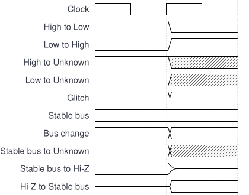

== Conventions

本章では、SC-ORCAのドキュメントで使用するデータ単位、文字表記、およびレジスタ記述の規則を示す。

=== Data Units

SC-ORCAのドキュメントでは、データサイズを以下の単位で表す。

* Byte: 8 bit
* Word: 32 bit (4 Byte)

Wordは、システムバスのデータ幅にかかわらず、32 bitのデータを示す。

=== Typographical Conventions

イタリック体:: 式や名称の中で、値に置き換えられる可変インデックスを示す。
たとえば、Register _N_ の _N_ はレジスタ番号を表す。
可変インデックスが取る値の範囲は、個別のレジスタ記述で定義する。

等幅体:: モジュール名、信号名、パラメータ名、ファイル名、コマンド、数値リテラル、およびソースコードに使用する。
ただし、表内で定義するモジュール名、信号名、パラメータ名、およびフィールド名には使用しない。
日本語の文章中で等幅体が日本語に隣接する場合は、等幅体の前後に半角スペースを入れる。

数値表記::
+
* `0x` で始まる数値は16進数を示す。
* `0b` で始まる数値は2進数を示す。
* 接頭辞のない数値は10進数を示す。
* RTLの値を示す場合は、 `32'h0000_0000` などのSystemVerilog数値リテラルを使用することがある。

=== Timing diagrams

タイミングチャートで使用される各要素については、Key to timing diagram conventionsの図で説明しています。

バスや信号の網掛け部分は不定であり、それ以外の白または色付きのバス信号は安定状態であることを示します。

.Key to timing diagram conventions

=== Register Description Conventions

レジスタを構成するフィールドの情報は、以下のような表で示す。

[cols="4,15,25,4,7",options="header",]
|===
| Bit  | Field       | Description                                                 | R/W | Reset
| 31:0 | Scratch Pad | Softwareにより自由に読み書き可能な汎用レジスタフィールド。  | R/W | 0x00000000
|===

各項目の意味は以下のとおりである。

Bit:: レジスタ内のビット位置またはビット範囲を示す。
31:0はbit 31からbit 0までの32 bitフィールドを示す。

Field:: フィールド名を示す。

Description:: フィールドの機能と設定内容を示す。

R/W:: フィールドのアクセス属性を示す。アクセス属性の意味を以下に示す。
+
[cols="1,4",width=55%,options="header",]
|===
| Access | Description
| R      | 読み出しが可能。書き込みアクセスではエラーは発生せず、このフィールドの値には影響しない
| W      | 書き込みが可能。読み出しアクセスではエラーは発生せず、読み出し値は意味を持たない
| R/W    | 読み出しと書き込みが可能
| R/W1C  | 読み出しが可能。1を書き込むと対応するビットがクリアされ、0を書き込んだビットには影響しない
|===

Reset:: リセット後のフィールド値を示す。 `Config.` はRTLコンフィギュレーションによって値が決定されることを示す。
`Variable` はIPコアのバージョンなどによって値が変化することを示す。
